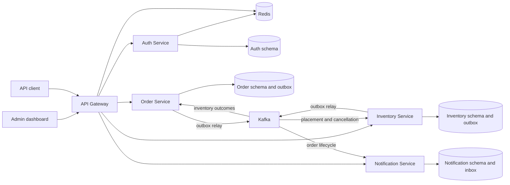
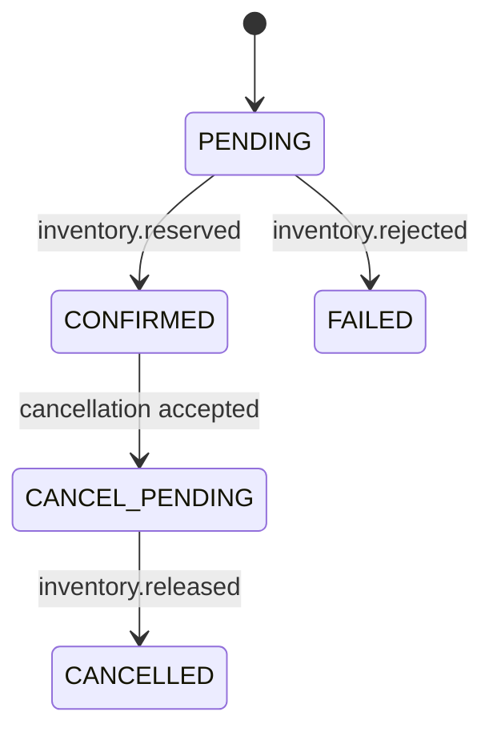
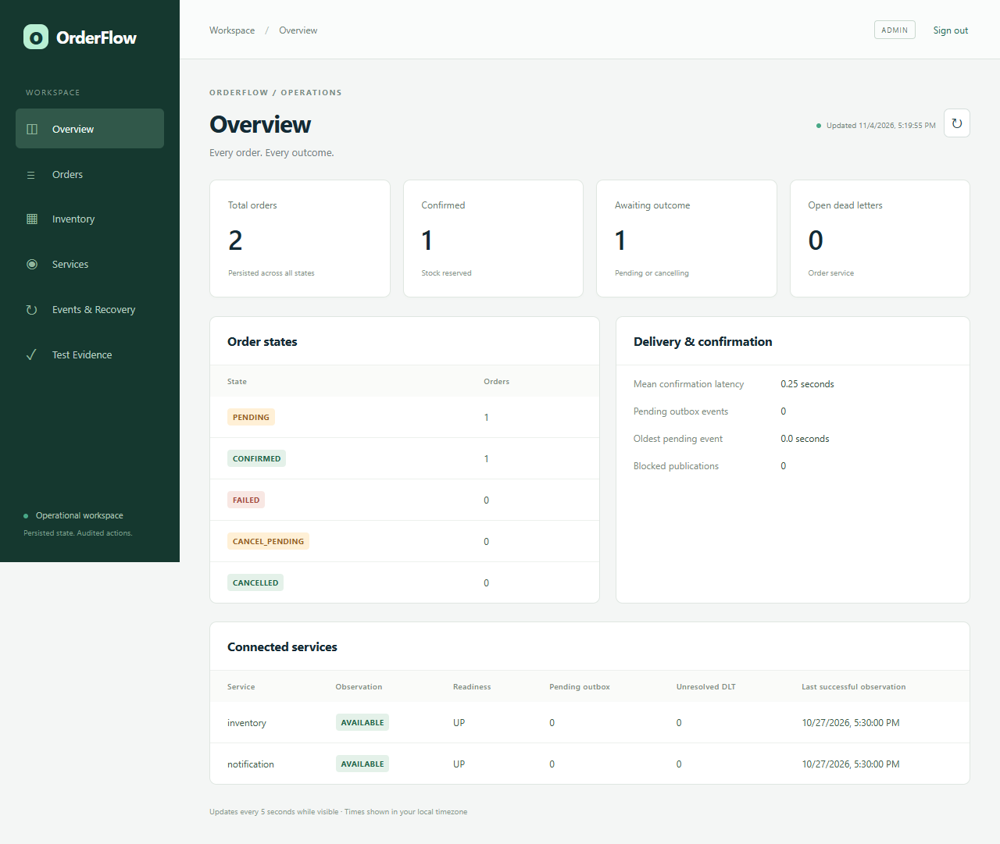

# OrderFlow

[](https://github.com/Jugal-632/OrderFlow/actions/workflows/ci.yml)

**Event-driven order management with durable messaging, stock reservation, and controlled recovery.**

OrderFlow is a Java microservices portfolio project that follows an order from creation to inventory confirmation, notification, and cancellation. It focuses on the failure cases behind that workflow: repeated requests, duplicate messages, concurrent stock updates, service crashes, and broker outages.

The application runs locally with Docker Compose. Hosted CI verifies tests, container startup, recovery scenarios, and image security. **AWS deployment is planned; it has not been completed.**

## What it demonstrates

- **Transactional outbox:** business changes and outgoing events commit together in PostgreSQL; relays publish committed events to Kafka.
- **Durable request idempotency:** repeated create/cancel requests return the stored result, scoped to the authenticated customer and operation.
- **Reliable inventory processing:** atomic stock deduction, inbox deduplication, reservations, and persisted decisions prevent repeated stock effects.
- **Cancellation with compensation:** a confirmed order becomes `CANCEL_PENDING` until inventory releases its reservation, then becomes `CANCELLED`.
- **Security at service boundaries:** JWT validation, Redis-backed revocation, role checks, order ownership, rate limits, and correlation IDs.
- **Operational recovery:** an admin dashboard exposes order state, dependencies, Kafka information, dead letters, audited replay, and test evidence.

## The problem: two writes can disagree

Creating an order requires both a database write and an event telling Inventory to reserve stock. If those happen independently, a crash can leave an order with no event—or an event for an order that never committed.

OrderFlow stores the order and its outbox event in one database transaction. A relay publishes the event afterward and marks it published after Kafka acknowledges it. A crash between publishing and marking the row can still cause redelivery, so consumers also use durable inbox records and domain-level decision checks.

This is **at-least-once delivery with idempotent business processing**, not a claim of exactly-once delivery across PostgreSQL and Kafka.

## Architecture



The local environment uses one PostgreSQL instance with separate service schemas and database roles. Kafka, ZooKeeper, Redis, and Kafka UI run alongside the application. Service and management endpoints remain internal to the container network; browser traffic goes through Gateway.

### Order lifecycle

1. The client submits a product, quantity, and `Idempotency-Key` through Gateway.
2. Order commits the idempotency result, a `PENDING` order, history, and `order.placed` to its outbox.
3. Inventory consumes the event and commits either a reservation with `inventory.reserved` or a rejection with `inventory.rejected`.
4. Order applies the inventory outcome and emits `order.confirmed` or `order.failed`.
5. Notification records lifecycle notifications atomically with its inbox entry.
6. Cancellation of a confirmed order emits `order.cancel.requested`; Inventory restores stock once and emits `inventory.released`; Order completes cancellation and emits `order.cancelled`.



## Tech stack

| Area | Technology |
|---|---|
| Backend | Java 21, Spring Boot 4.0.9, Spring Cloud 2025.1.4 |
| Persistence | PostgreSQL, Flyway, transactional SQL |
| Messaging | Apache Kafka, Spring Kafka |
| Identity and limits | JWT, Spring Security, Redis |
| Frontend | JavaScript ES modules, HTML/CSS, Node.js server |
| Testing | JUnit, Testcontainers, Awaitility, Node test runner, Playwright |
| Observability | Structured JSON logs, MDC context, Micrometer, Prometheus-format endpoints, CloudWatch export support |
| Delivery | Maven Wrapper, multi-stage Dockerfiles, Docker Compose, GitHub Actions |
| Image verification | Trivy vulnerability/secret scans and CycloneDX SBOMs |

Dependency versions are maintained in [pom.xml](pom.xml), frontend manifests, and the container definitions.

## Run locally

### Prerequisites

- Git and Python 3.9+ (`python3` may be the command on Linux/macOS).
- Docker with Compose v2 and Linux containers. Allow at least 8 GiB for Docker and adequate free host memory.
- Ports `5173`, `8080`, `8090`, `5432`, `6379`, and `9092` available, or change the corresponding settings in `.env`.
- Java 21 is needed only for host-side Maven builds; containers supply Java for the Compose setup. Node.js 22 is needed for host-side frontend development/tests.

```sh
git clone https://github.com/Jugal-632/OrderFlow.git
cd OrderFlow
python scripts/local_env.py
docker compose --env-file .env --profile compose config -q
docker compose --env-file .env --profile compose build -q
docker compose --env-file .env --profile compose up -d --wait --wait-timeout 600
```

The generator creates random development passwords and signing material in ignored `.env`. **It preserves existing values.** `.env.example` is a template, not a ready-to-use credentials file.

| Entry point | Address |
|---|---|
| Admin dashboard | http://localhost:5173 |
| API Gateway | http://localhost:8080 |
| Kafka UI | http://localhost:8090 |

Sign into the dashboard using `BOOTSTRAP_ADMIN_EMAIL` and `BOOTSTRAP_ADMIN_PASSWORD` from your local `.env`. Customer API credentials are in the corresponding `BOOTSTRAP_CUSTOMER_*` entries. The dashboard requires the ADMIN role. Tokens stay in memory and are cleared on page reload.

The database starts without an inventory product. To add one disposable local demo product without resetting existing stock:

```sh
docker compose exec -T postgres psql -U orderflow -d orderflow_db -v ON_ERROR_STOP=1 -c "INSERT INTO inventory_schema.inventory(product_id, product_name, quantity_available) VALUES ('11111111-1111-4111-8111-111111111111', 'Demo product', 50) ON CONFLICT (product_id) DO NOTHING;"
```

Check startup or stop the stack:

```sh
docker compose --profile compose ps
docker compose --profile compose logs --tail=100 order-service
docker compose --profile compose down
```

`down` retains volumes. Avoid `down -v` when you need existing data. Changing `.env` does not rotate passwords already stored in PostgreSQL or reset existing Auth accounts. See [local stack and verification](docs/local-stack.md) for isolated test projects and recovery details.

## Try the API

Use the generated customer credentials to log in. The following are curl examples; use `curl.exe` in Windows PowerShell if `curl` resolves to another command. Replace placeholders locally—never commit actual passwords or tokens.

```sh
curl -X POST http://localhost:8080/auth/login \
  -H "Content-Type: application/json" \
  -d '{"email":"<BOOTSTRAP_CUSTOMER_EMAIL>","password":"<BOOTSTRAP_CUSTOMER_PASSWORD>"}'
```

Copy `accessToken` from the response, then create an order for the seeded product:

```sh
curl -i -X POST http://localhost:8080/api/orders \
  -H "Authorization: Bearer <accessToken>" \
  -H "Content-Type: application/json" \
  -H "Idempotency-Key: demo-create-001" \
  -d '{"productId":"11111111-1111-4111-8111-111111111111","quantity":2}'

curl http://localhost:8080/api/orders/<orderId> \
  -H "Authorization: Bearer <accessToken>"
```

Creation returns `201`; inventory confirmation is asynchronous. Poll the order to see its current status, version, and timeline. Customer identity comes from the token, not the request body.

- Repeat the same request and key: the stored response is returned with `Idempotent-Replayed: true`.
- Reuse the key with a different product/quantity: `409 IDEMPOTENCY_KEY_REUSED`.
- Use a new key and request more than available stock: the order eventually becomes `FAILED` with a failure reason.
- Use a fresh key for each intended new operation.

Once the order is `CONFIRMED`, cancel it:

```sh
curl -i -X POST http://localhost:8080/api/orders/<orderId>/cancel \
  -H "Authorization: Bearer <accessToken>" \
  -H "Idempotency-Key: demo-cancel-001"
```

Cancellation returns `202` with `CANCEL_PENDING`; poll until `CANCELLED`. The reservation is released before cancellation completes. More request examples are in [requests.http](requests.http).

### Main routes

| Endpoint | Purpose / access |
|---|---|
| `POST /auth/login` | Obtain a JWT |
| `POST /auth/logout`, `GET /auth/me` | Authenticated session operations |
| `POST /api/orders` | Create an order; requires an idempotency key |
| `GET /api/orders/{id}` | Order status and timeline; customer ownership enforced |
| `POST /api/orders/{id}/cancel` | Cancel a confirmed order; requires an idempotency key |
| `GET /api/dashboard/overview/stats` | ADMIN operational summary |
| `GET /api/dashboard/services/health` | ADMIN dependency status |
| `GET /api/dashboard/kafka/topics` | ADMIN Kafka metadata and lag |
| `GET /api/dashboard/test-runs` | ADMIN read-only test evidence |
| `GET /api/inventory`, `GET /api/notifications` | ADMIN stock and notification views |
| `GET /api/ops/{service}/dead-letters` | ADMIN dead-letter inspection |
| `POST /api/ops/{service}/dead-letters/{id}/replay` | ADMIN audited replay; reason and idempotency key required |

For recovery routes, `{service}` is `order`, `inventory`, or `notification`. Customers receive `404` when reading another customer's order and `403` for ADMIN-only operations.

## Operations dashboard

Six pages cover **Overview**, **Orders**, **Inventory**, **Services**, **Events & Recovery**, and **Test Evidence**. The UI polls every five seconds while visible, pauses when hidden, and displays stale/unavailable states when dependencies fail.



The screenshot is captured test evidence; it is not a live hosted deployment.

## Tests and verified results

The [GitHub Actions workflow](.github/workflows/ci.yml) runs backend unit/contract/migration/integration tests, frontend unit/browser checks, clean image builds, healthy Compose startup, and real-stack recovery scenarios. It also scans all six application images for HIGH/CRITICAL vulnerabilities and secrets, generates SBOMs, and uploads diagnostic artifacts. A failed security gate fails CI.

[Verified hosted run for the runtime security fix](https://github.com/Jugal-632/OrderFlow/actions/runs/44372460755): **tests and containers passed**. Findings are tied to the scanned commit and vulnerability database; a past scan is not a guarantee against future advisories.

### Local performance evidence

The accepted November 13, 2026 Compose benchmark used 20 authenticated users, a 60-second warm-up, and a five-minute measured workload targeting 10 requests/second:

| Measurement | Observed result |
|---|---:|
| Successful measured requests | 3,000 |
| Request errors | 0 |
| Create-order latency, p95 | 78.189 ms |
| Confirmation latency, p95 | 1,916.007 ms |
| Total confirmed orders, including warm-up | 3,600 |
| Final stock, from 10,000 units | 6,400 |
| Notifications / published order events | 7,200 each |
| Duplicate business events | 0 |

This was a local Docker Desktop run, not a production capacity claim. Java containers had 768 MiB memory limits and two CPUs each; the host had approximately 16 GiB RAM. Earlier runs failed under local runtime contention and remain in the private development archive. The passing result does not establish the definitive cause of those stalls. The accepted workload also included a forced database checkpoint under load.

### Recovery scenarios verified

| Scenario | Expected and verified behavior |
|---|---|
| Order process killed during a database write | Uncommitted work rolls back; retry succeeds |
| Inventory stops with an unprocessed order | Processing catches up after restart |
| Broker outage with pending Inventory outbox | Committed outcome survives and is published after recovery |
| Confirmed-order cancellation | Stock is restored without duplicate compensation |
| Complete Compose recreation | Kafka/ZooKeeper metadata and persisted business state survive |

### Run checks yourself

With Java 21 and Docker available:

```sh
./mvnw -q verify -Dapi.version=1.44
cd frontend
npm ci
npm test
npx playwright install --with-deps chrome
npx playwright test tests/browser/dashboard.spec.js
```

On Windows, use `mvnw.cmd` for Maven. See [local stack verification](docs/local-stack.md) for Docker/Testcontainers setup and the isolated smoke/chaos script. Run destructive recovery scenarios only against the designated disposable verification project, not a stack containing data you need.

## Repository map

| Path | Responsibility |
|---|---|
| `api-gateway/` | Routing, authentication boundary, rate limits, CORS |
| `auth-service/` | Users, roles, JWT issuance and logout |
| `order-service/` | Order state machine, HTTP idempotency, history, dashboard aggregation |
| `inventory-service/` | Stock reservations, decisions, release compensation |
| `notification-service/` | Durable in-app lifecycle notifications |
| `event-contracts/` | Event envelopes, validation and contract fixtures |
| `security-common/` | Shared identity and telemetry support |
| `ops-common/` | Dead-letter indexing and audited replay |
| `frontend/` | Admin operations UI and browser tests |
| `containers/` | Database initialization and readiness probe |
| `scripts/` | Local environment generation, verification and evidence tools |
| `docs/runbooks/` | Alerts, backup/restore and recovery procedures |

## Documentation and boundaries

- [Local setup and CI](docs/local-stack.md)
- [Synthetic test credentials](docs/test-fixtures.md)
- [Observability](docs/runbooks/observability.md)
- [Backup and restore](docs/runbooks/backup-restore.md)
- [Broker outages and replay](docs/runbooks/broker-and-replay.md)
- [Stuck-order investigation](docs/runbooks/stuck-order.md)

This is a portfolio demonstration of reliability mechanisms. The frontend is an admin operations console, not a customer storefront. Notifications are persisted in-app records, not email/SMS delivery. The Compose stack is a local environment, not a highly available deployment. AWS infrastructure, deployment evidence, and cost/teardown verification remain future work.

Historical development evidence and packaging helpers may refer to private archived reports that are not distributed with the public repository. Build, test, and local runtime instructions above do not require that archive.
